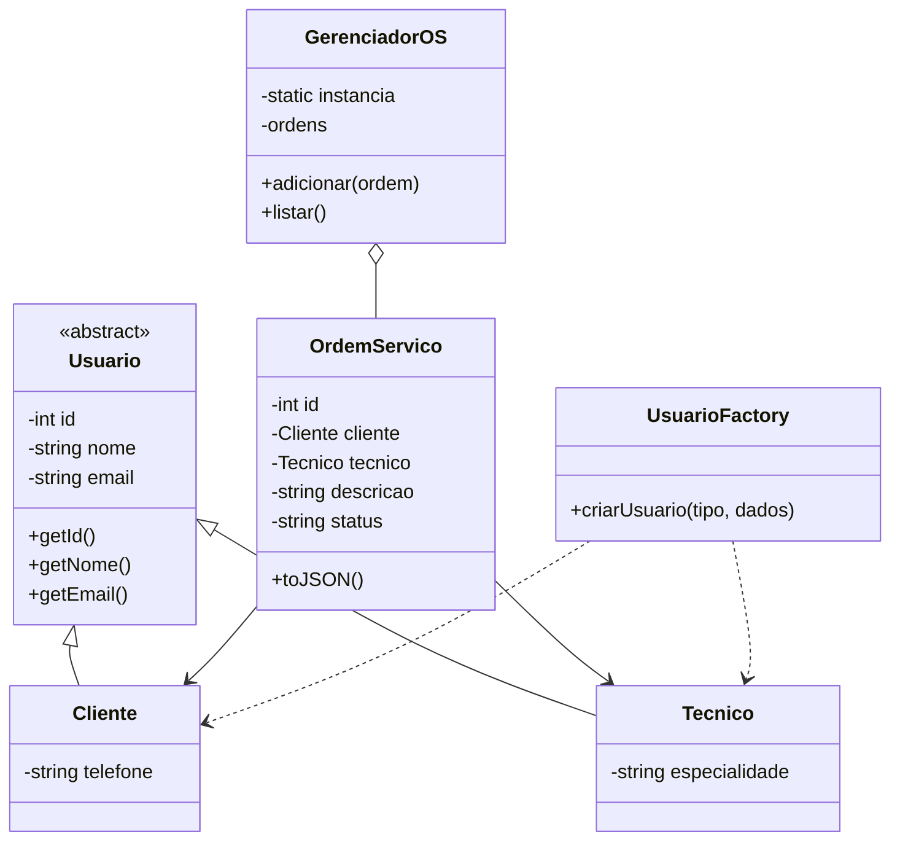

# TechOS Core — Sprint Express

## 1. Descrição do projeto

O TechOS Core é um sistema de gerenciamento de ordens de serviço para assistência técnica, desenvolvido em JavaScript com Programação Orientada a Objetos.

## 2. Histórias de usuário — INVEST

### US01 — Abrir ordem de serviço

Como técnico, quero registrar uma ordem de serviço para organizar os atendimentos.

**Critérios de aceitação:**
- O cliente deve ser válido.
- O técnico deve ser válido.
- A descrição do serviço é obrigatória.
- O status inicial deve ser ABERTA.

### US02 — Consultar ordem de serviço

Como cliente, quero consultar as informações da minha ordem de serviço para acompanhar o atendimento do meu equipamento.

**Critérios de aceitação:**
- O sistema deve listar as ordens cadastradas.
- Cada ordem deve apresentar ID, cliente, técnico, descrição e status.
- As informações devem corresponder aos dados registrados.

## 3. Requisitos não funcionais

**RNF01 — Segurança:** validar os dados recebidos e prevenir vulnerabilidades como XSS caso o sistema seja integrado a uma interface web.

**RNF02 — Desempenho:** a criação de uma ordem de serviço deve levar menos de dois segundos em condições normais, requisito que deverá ser confirmado por testes.

## 4. Modelagem POO

- Usuario: classe-base abstrata.
- Cliente: subclasse de Usuario, com telefone.
- Tecnico: subclasse de Usuario, com especialidade.
- OrdemServico: representa uma ordem de serviço.
- UsuarioFactory: cria clientes e técnicos.
- GerenciadorOS: gerencia a lista de ordens.

## 5. Padrões criacionais

**Factory Method:** centraliza a criação de clientes e técnicos conforme o tipo informado.

**Singleton:** mantém uma única instância de GerenciadorOS durante a execução do módulo.

## 6. Diagrama de classes



## 7. Tecnologias utilizadas

- JavaScript ES6 Modules
- Node.js
- Git e GitHub
- Programação Orientada a Objetos

## 8. Como executar

No terminal do Windows, execute:

```bash
npm.cmd start
```

## 9. Testes realizados

- Criação de cliente e técnico.
- Verificação da instância única do Singleton.
- Registro de ordem de serviço.
- Verificação do status inicial ABERTA.
- Listagem das ordens cadastradas.
